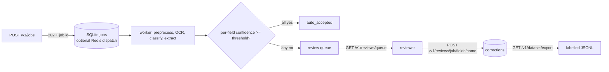

# DocuMind OCR Intelligence

<p align="center">
  <a href="https://github.com/ashiksharonm/DocuMind-OCR-Intelligence/actions/workflows/ci.yml"></a>
  
  
  
</p>

> **Document extraction with confidence-routed human review.** Upload an invoice or receipt, get vendor, date and total with a per-field confidence, and let the system route only the uncertain fields to a human. Reviewer decisions are stored and exported as a labelled dataset you can use to improve the extractor.
>
> **Status:** portfolio project. OCR is free and CPU-only (Tesseract by default; PaddleOCR/EasyOCR optional). Measured numbers are on seeded synthetic documents only (see [Results](#results-synthetic-documents-only)); nothing here is a claim about real-world accuracy.

## Confidence-routed human review



- **Async API:** `POST /v1/jobs` stores the upload and returns `202`; a separate worker (`python -m app.review.worker`, or `EMBEDDED_WORKER=true`) processes it. SQLite is the default store and queue; set `REDIS_URL` to dispatch via Redis (SQLite stays the source of truth). Crashed workers are recovered by a visibility timeout with bounded retries.
- **Per-field confidence:** extractor heuristic score times the mean OCR confidence of the tokens that spell the value, with an arithmetic cross-check (subtotal + tax must equal the total). It is a ranking signal, not a calibrated probability.
- **Routing:** fields below `REVIEW_THRESHOLD` (default 0.75) or empty go to `GET /v1/reviews/queue`, lowest confidence first. `POST /v1/reviews/{job}/fields/{field}` with `confirm` or `correct` records the decision (value validated: ISO date, numeric amount).
- **Dataset export:** `GET /v1/dataset/export` streams JSONL with `predicted`, `label`, `confidence` and `source` (`human_corrected`, `human_confirmed`, or `auto_accepted` with `?include=all`). `GET /v1/stats` reports review and correction rates.

### Quickstart

```bash
cd documind-ocr && docker compose up --build            # api on :8000 + worker (Tesseract inside the image)
curl -F file=@dataset/sample_docs/invoice_001.jpg localhost:8000/v1/jobs
curl localhost:8000/v1/reviews/queue                    # then POST decisions, then GET /v1/dataset/export
```

Optional `API_KEY` protects `/v1/*` (send `X-API-Key`). Design, data model and failure modes: [documind-ocr/docs/DESIGN.md](documind-ocr/docs/DESIGN.md). A Gradio demo for Hugging Face Spaces is in [`documind-ocr/space`](documind-ocr/space) (not deployed yet).

### Results (synthetic documents only)

`scripts/evaluate_synthetic.py` renders 100 seeded invoices/receipts across five degradation levels (clean, noisy, rotated, degraded, severe), runs the real pipeline (Tesseract, CPU), and compares to the known labels. Exact match on vendor (case-insensitive), ISO date, and total (within 0.005). Routing at threshold 0.75:

| seed | field accuracy | fields flagged | accuracy of auto-accepted | accuracy of flagged | docs fully auto with an error |
|---|---|---|---|---|---|
| 0 | 0.927 | 8.7% | 1.000 | 0.154 | 0/100 |
| 1 | 0.937 | 7.3% | 0.993 | 0.227 | 2/100 |

Accuracy by degradation (seed 0): clean 1.00, noisy 1.00, rotated 1.00, degraded 0.98, severe 0.65. Auto-accepted fields are far more accurate than flagged ones, and only about 8% of fields are flagged, most of them indeed wrong. Design iterations happened on this data: the arithmetic cross-check and the `severe` level were added after a first run on easier data showed little separation, and vendor-line confidence was raised after a run in which every vendor line was flagged. Both seeds were re-run after the last change, so neither is a clean holdout, and real scans will behave differently. Environment: Tesseract 5.5.2, OpenCV 4.10.0, numpy 1.26.4, spaCy 3.7.5 (the pinned stack), Apple M5 CPU, about 0.5 s per document. Reports: [`documind-ocr/benchmarks`](documind-ocr/benchmarks); reproduce with `python scripts/evaluate_synthetic.py --n 100 --seed 0`.

### Limitations

- Three fields only (vendor, date, total); currency is assumed USD; one vendor-line heuristic, not a trained model.
- `dataset/labels.csv` lists five images that are not in the repo, so `scripts/evaluate.py` cannot run on the bundled data; use `evaluate_synthetic.py`.
- Threshold 0.75 was not tuned on real documents. No PII redaction or encryption of stored uploads: do not use with sensitive documents without adding them.
- The Gradio demo keeps data in a temp directory; the legacy `/extract` and `/batch` endpoints are synchronous and unchanged apart from the OCR default.

---

## Table of Contents

1. [Overview](#overview)
2. [Key Metrics](#key-metrics)
3. [Architecture](#architecture)
4. [Features](#features)
5. [Annotation Workflow Integration](#annotation-workflow-integration)
6. [API Reference](#api-reference)
7. [Setup & Running](#setup--running)
8. [Docker](#docker)
9. [Evaluation & Benchmarks](#evaluation--benchmarks)
10. [Project Structure](#project-structure)
11. [Tech Stack](#tech-stack)
12. [Contributing](#contributing)

---

## Overview

DocuMind OCR Intelligence is a **scalable computer vision + NLP data processing pipeline** built for the food-tech industry. It automates the extraction of key financial fields — vendor name, invoice date, and total amount — from unstructured image and PDF documents at production scale.

**Problem it solves:** Food-tech companies process thousands of restaurant invoices, delivery receipts, and POS transaction slips daily. Manual visual review is slow, error-prone, and expensive. DocuMind eliminates that bottleneck.

---

## Key Metrics

| Item | Status |
|---|---|
| Field extraction accuracy | Measured on synthetic documents only (see Results above); no real-document benchmark |
| Preprocessing time | Measured per document by `scripts/benchmark_preprocess.py` (hardware dependent; the "manual baseline" it compares against is an assumed 30 s, not a measurement) |
| End-to-end latency | About 0.5 s per synthetic document on Apple M5 (Tesseract, CPU) in `evaluate_synthetic.py`; also tracked at runtime via `/metrics` |
| Batch concurrency | `asyncio.gather` + `ThreadPoolExecutor(max_workers=4)` (configuration, not a measured speedup) |
| Supported formats | PDF, JPG, PNG, MP4/AVI (video frames) |

---

## Architecture

```
                  ┌─────────────────────────────────────────────────────┐
                  │                  FastAPI (Uvicorn)                   │
                  │  POST /extract   POST /batch   GET /metrics          │
                  └────────────────────┬────────────────────────────────┘
                                       │
            ┌──────────────────────────▼──────────────────────────────┐
            │                   Ingestion Layer                        │
            │   PDF → pdf2image    |    Image/Video → OpenCV           │
            │   Video → Key-frame extraction (uniform sampling)        │
            └──────────────────────────┬──────────────────────────────┘
                                       │
            ┌──────────────────────────▼──────────────────────────────┐
            │             Preprocessing Pipeline                        │
            │  Deskew → Grayscale → CLAHE → Denoise → Threshold →      │
            │  Morphological Clean                                      │
            └──────────────────────────┬──────────────────────────────┘
                                       │
            ┌──────────────────────────▼──────────────────────────────┐
            │                   Hybrid OCR Engine                      │
            │     Tesseract (default) · PaddleOCR / EasyOCR optional   │
            │     Results sorted by spatial reading order (Y→X)        │
            └──────────┬──────────────────────────┬────────────────────┘
                       │                          │
          ┌────────────▼────────┐    ┌────────────▼──────────────────┐
          │   Classification    │    │      Field Extraction          │
          │  Invoice / Receipt  │    │  Vendor  · Date  · Amount      │
          │  Keyword + heuristic│    │  Regex · Layout · spaCy NER    │
          └────────────┬────────┘    └────────────┬──────────────────┘
                       │                          │
                       └──────────┬───────────────┘
                                  │
            ┌─────────────────────▼───────────────────────────────────┐
            │              Response + Artifacts                        │
            │  JSON response  |  Processed images  |  OCR debug JSON   │
            └─────────────────────────────────────────────────────────┘
```

---

## Features

### Core Pipeline
- **Multi-Format Ingestion** — PDF (via `pdf2image`), images (JPG/PNG/BMP/TIFF), and video files (MP4/AVI/MOV) with automatic key-frame extraction
- **Full Preprocessing** — deskew, CLAHE contrast enhancement, NLM denoising, adaptive binarisation, morphological ink-bleed removal
- **OCR** — Tesseract by default (free, CPU); PaddleOCR or EasyOCR via `OCR_ENGINE` and `requirements-extra.txt`; tokens grouped into reading-order lines
- **Intelligent Field Extraction** — regex patterns + layout heuristics + spaCy NER (`en_core_web_sm`) for vendor, date, and amount
- **Document Classification** — distinguishes invoices vs. receipts using keyword scoring + layout analysis
- **Extractive Summarisation** — 3-bullet summary of the most information-dense sentences

### Scalability & Operations
- **Async Batch Processing** — `/batch` endpoint accepts a ZIP archive; processes all documents concurrently via `asyncio.gather` + `ThreadPoolExecutor`
- **Performance Middleware** — `LatencyMiddleware` tracks p50/p95/p99 per request, warns on SLA breaches, exposes `X-Process-Time-Ms` response header
- **Observability** — `/metrics` endpoint with real-time latency stats; `/health` for load-balancer checks
- **Containerised** — multi-stage Docker build, non-root user, `HEALTHCHECK`, resource limits

---

## Annotation Workflow Integration

DocuMind integrates with three industry-standard annotation platforms to build and maintain high-accuracy NLP training datasets:

### Supported Platforms

| Platform | Export Format | Loader Function |
|---|---|---|
| **CVAT** | XML (Images 1.1 + Video tracks) | `load_cvat(xml_path)` |
| **Label Studio** | JSON (RectangleLabels, PolygonLabels) | `load_label_studio(json_path)` |
| **Roboflow** | YOLO `.txt` (normalised bbox) | `load_roboflow(labels_dir, class_map)` |

All loaders normalise output to a common `AnnotationRecord` schema:

```python
from app.pipelines.annotation_loader import load_cvat, load_label_studio, load_roboflow, merge_annotations

# Load from any tool
cvat_records     = load_cvat("exports/cvat_annotations.xml")
ls_records       = load_label_studio("exports/label_studio_export.json")
roboflow_records = load_roboflow(
    "dataset/labels/",
    class_map={0: "invoice", 1: "receipt", 2: "field_vendor", 3: "field_date", 4: "field_amount"},
    images_dir="dataset/images/",
)

# Merge from multiple tools into one unified dataset
all_records = merge_annotations(cvat_records, ls_records, roboflow_records)
print(f"Total annotations: {len(all_records)}")

# Each record has: image_path, label, bbox (x_min/y_min/x_max/y_max), source_tool, attributes
for r in all_records[:3]:
    print(r.to_dict())
```

### Annotation Record Schema

```json
{
  "image_path": "invoice_001.jpg",
  "label": "field_vendor",
  "bbox": { "x_min": 30.0, "y_min": 40.0, "x_max": 300.0, "y_max": 70.0 },
  "source_tool": "cvat",
  "attributes": { "occluded": false, "image_width": 640 }
}
```

---

## API Reference

### `POST /extract` — Single Document Extraction

Accepts a PDF or image file. Returns structured JSON with extracted fields, classification, confidence scores, and debug info.

```bash
curl -X POST "http://localhost:8000/extract" \
     -F "file=@/path/to/invoice.pdf"
```

**Response**

```json
{
  "doc_id": "a1b2c3d4-...",
  "doc_type": "invoice",
  "classification_confidence": 0.8,
  "fields": {
    "vendor_name": { "value": "Green Garden Restaurant", "confidence": 0.8 },
    "invoice_date": { "value": "2024-01-15", "confidence": 0.9 },
    "total_amount": { "value": 1250.00, "currency": "USD", "confidence": 0.9 }
  },
  "summary": ["Invoice #INV-2024-001", "Total amount: $1,250.00", "Due: 2024-02-15"],
  "debug": {
    "ocr_engine": "tesseract",
    "pages": 1,
    "processing_time_ms": 843.2
  },
  "errors": []
}
```

---

### `POST /batch` — Batch Extraction (ZIP Archive)

Upload a ZIP file containing multiple invoice/receipt images. All documents are processed concurrently.

```bash
curl -X POST "http://localhost:8000/batch" \
     -F "file=@/path/to/invoices.zip"
```

**Response**

```json
{
  "total_documents": 25,
  "successful": 25,
  "failed": 0,
  "total_elapsed_sec": 18.4,
  "throughput_docs_per_sec": 1.36,
  "avg_latency_ms": 720.5,
  "max_latency_ms": 1843.2,
  "sub_2s_transactions_pct": 100.0,
  "results": [...]
}
```

---

### `GET /metrics` — Real-Time Latency Stats

```bash
curl http://localhost:8000/metrics
```

```json
// example response shape, values are not measurements
{
  "total_requests": 142,
  "p50_ms": 680.4,
  "p95_ms": 1420.1,
  "p99_ms": 1870.3,
  "avg_ms": 742.8,
  "max_ms": 1980.5,
  "sla_violation_pct": 0.0,
  "sla_threshold_ms": 2000.0
}
```

---

### `GET /health` — Health Check

```bash
curl http://localhost:8000/health
# {"status": "ok", "service": "DocuMind OCR", "version": "1.0.0"}
```

**Interactive API docs:** [`http://localhost:8000/docs`](http://localhost:8000/docs)

---

### Scalability & Operations
- **Async Batch Processing** — `/batch` endpoint accepts a ZIP archive; processes all documents concurrently via `asyncio.gather` + `ThreadPoolExecutor`
- **Performance Middleware** — `LatencyMiddleware` tracks p50/p95/p99 per request, warns on SLA breaches, exposes `X-Process-Time-Ms` response header
- **Observability** — `/metrics` endpoint with real-time latency stats; `/health` for load-balancer checks
- **Containerised** — multi-stage Docker build, non-root user, `HEALTHCHECK`, resource limits

### Prerequisites

- Python 3.11+
- Tesseract OCR
- Poppler (for PDF support)

### Local Setup

```bash
# 1. Install system dependencies
# macOS
brew install tesseract poppler

# Ubuntu / Debian
sudo apt-get install -y tesseract-ocr poppler-utils

# 2. Clone and install Python dependencies
git clone https://github.com/ashiksharonm/DocuMind-OCR-Intelligence.git
cd DocuMind-OCR-Intelligence

pip install -r documind-ocr/requirements.txt
python -m spacy download en_core_web_sm

# 3. Run the API
make run
# → API live at http://localhost:8000
# → Swagger UI at http://localhost:8000/docs
```

### Makefile Commands

| Command | Description |
|---|---|
| `make run` | Start dev server with hot reload |
| `make test` | Run full test suite |
| `make lint` | Lint with Ruff |
| `make build` | Build Docker image |
| `make docker-run` | Build and start via Docker Compose |
| `make clean` | Remove `__pycache__` and `.pytest_cache` |

---

## Docker

```bash
# Build and run (production)
make docker-run

# Or manually
cd documind-ocr
docker compose up --build

# Verify health
curl http://localhost:8000/health
```

The container uses:
- **Multi-stage build** — lean runtime image, no build tools in production
- **Non-root user** (`documind`, UID 1001) for security
- **HEALTHCHECK** — Docker monitors `/healthz` every 30 s; compose runs `api` + `worker` (+ optional Redis profile)
- **Resource limits** — 2 GB RAM, 2 vCPU
- **`restart: unless-stopped`** — automatic recovery

---

## Evaluation & Benchmarks

### Run Evaluation

```bash
# Add your labelled samples to: documind-ocr/dataset/sample_docs/
# Ground truth is in:          documind-ocr/dataset/labels.csv

cd documind-ocr
python scripts/evaluate.py
# → Report saved to: reports/eval_report.json
```

For a reproducible measurement use `python scripts/evaluate_synthetic.py` (results above). `evaluate.py` expects your own images listed in `labels.csv`.

### Run Preprocessing Benchmark

```bash
python scripts/benchmark_preprocess.py
# → Report saved to: reports/preprocess_benchmark.json
```

The script prints the measured automated time and a modelled reduction against an assumed 30 s manual baseline; only the automated time is a measurement.

---

## Project Structure

```
DocuMindOCRIntelligence/
├── Makefile
├── .gitignore
└── documind-ocr/
    ├── Dockerfile                   # Multi-stage build
    ├── docker-compose.yml           # Production compose with healthcheck
    ├── requirements.txt
    ├── .github/
    │   └── workflows/
    │       └── ci.yml               # CI: lint → type-check → test → benchmark
    ├── app/
    │   ├── main.py                  # FastAPI app + LatencyMiddleware
    │   ├── api/
    │   │   └── routes.py            # /extract · /batch · /metrics
    │   ├── core/
    │   │   └── config.py            # Settings
    │   ├── middleware/
    │   │   └── perf.py              # LatencyMiddleware, p50/p95/p99, SLA alerts
    │   ├── pipelines/
    │   │   ├── annotation_loader.py # CVAT · Label Studio · Roboflow parsers
    │   │   ├── batch_processor.py   # Async batch + video frame extraction
    │   │   ├── classify.py          # Document type classification
    │   │   ├── extract_fields.py    # Regex + NLP field extraction
    │   │   ├── ingest.py            # PDF + Image ingestion
    │   │   ├── ocr.py               # Tesseract (default), PaddleOCR / EasyOCR optional
    │   │   ├── preprocess.py        # Full CV preprocessing pipeline
    │   │   └── summarize.py         # Extractive summarisation
    │   └── schemas/
    │       └── response_models.py   # Pydantic response models
    ├── dataset/
    │   ├── labels.csv               # Ground-truth annotations
    │   └── sample_docs/             # Place test documents here
    ├── scripts/
    │   ├── evaluate.py              # F1 / accuracy evaluation
    │   └── benchmark_preprocess.py  # preprocessing timing benchmark
    ├── tests/
    │   ├── test_pipelines.py        # Core pipeline unit tests
    │   ├── test_annotation_loader.py # CVAT · Label Studio · Roboflow tests
    │   └── test_preprocess_timing.py # Preprocessing SLA + reduction tests
    ├── artifacts/                   # Per-doc debug images + JSONs (git-ignored)
    └── reports/                     # Eval + benchmark JSON reports (git-ignored)
```

---

## Tech Stack

| Layer | Technology |
|---|---|
| **API Framework** | FastAPI 0.115, Uvicorn |
| **Computer Vision** | OpenCV 4.10 (CLAHE, adaptive threshold, deskew, morphology) |
| **OCR** | Tesseract (default); PaddleOCR / EasyOCR optional |
| **PDF Processing** | pdf2image (Poppler) |
| **NLP** | spaCy 3.7 (`en_core_web_sm`), dateparser, regex |
| **Data** | NumPy 1.26, Pandas 2.2 |
| **Annotation Tools** | CVAT, Label Studio, Roboflow (via parsers) |
| **Containers** | Docker (multi-stage), Docker Compose |
| **CI/CD** | GitHub Actions |
| **Testing** | pytest, pytest-asyncio, httpx |
| **Code Quality** | Ruff (lint), mypy (types) |

---

## Contributing

1. Fork the repository
2. Create a feature branch: `git checkout -b feat/your-feature`
3. Make your changes and add tests
4. Ensure all checks pass: `make lint && make test`
5. Open a Pull Request against `main`

---

## License

GPL-3.0 — see [LICENSE](../LICENSE)
