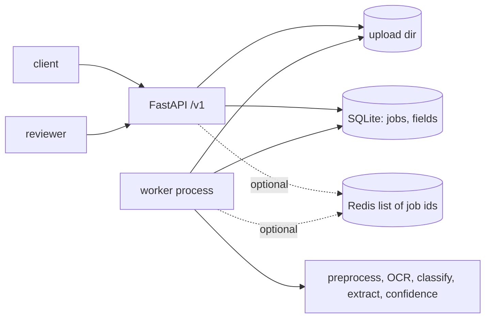

# Confidence-routed human review: design

## Problem
OCR extraction of invoices and receipts is wrong often enough that every field cannot be trusted blindly, and reviewing every document by hand defeats the point. DocuMind scores each extracted field, auto-accepts the confident ones, and routes the rest to a human. The decisions double as labelled training data.

## Requirements
Functional
- Accept an upload without blocking the caller (202 + job id); process it in a background worker.
- Extract vendor, date and total with a per-field confidence and the location of the evidence.
- Route fields below a threshold (or empty) to a review queue; accept confirm/correct decisions.
- Export reviewed fields as a labelled JSONL dataset.
- Free OCR on CPU (Tesseract default; PaddleOCR/EasyOCR optional). Docker compose with a worker; Gradio demo.

Non-functional
- Zero required services beyond Python and the Tesseract binary: SQLite for state, polling for dispatch; Redis optional.
- At-least-once processing: a crashed worker's job is retried (visibility timeout, max attempts), then marked failed.
- Uploads capped at 10 MB, decoded before being queued, stored under server-generated names.
- Structured logs with a request ID; `/healthz` and `/readyz`.

## Architecture


```mermaid
sequenceDiagram
  participant C as Client
  participant A as API
  participant D as SQLite
  participant W as Worker
  participant R as Reviewer
  C->>A: POST /v1/jobs (file)
  A->>D: insert job (queued)
  A-->>C: 202 job_id
  W->>D: claim oldest queued (BEGIN IMMEDIATE)
  W->>W: preprocess, OCR, extract, score
  W->>D: store fields, status auto_accepted or needs_review
  R->>A: GET /v1/reviews/queue
  A-->>R: pending fields, lowest confidence first
  R->>A: POST /v1/reviews/{job}/fields/{field} (confirm or correct)
  A->>D: label, source, reviewer; job reviewed when no pending field is left
  C->>A: GET /v1/dataset/export
```

## Data model
- `jobs(id, status, filename, sha256, file_path, preview_path, attempts, started_at, doc_type, ocr_engine, ocr_text, threshold, error, ...)`; status: `queued, processing, auto_accepted, needs_review, reviewed, failed`.
- `fields(job_id, name, predicted, confidence, status, label, source, reviewer, reviewed_at, detail)`; status: `auto_accepted, pending_review, confirmed, corrected`; `detail` holds extractor and OCR confidence, raw text and bbox.
- Export record: `{job_id, sha256, filename, doc_type, ocr_engine, ocr_text, fields: {name: {predicted, label, confidence, source}}}`.

## API contract
| method, path | purpose |
|---|---|
| POST /v1/jobs | upload (image or PDF), returns 202 `{job_id, status_url}`; 400 undecodable, 413 too large |
| GET /v1/jobs/{id} | status and fields; GET /v1/jobs/{id}/image page preview |
| GET /v1/reviews/queue?limit&offset | pending fields |
| POST /v1/reviews/{job}/fields/{field} | `{action: confirm or correct, reviewer, value?}`; 422 on invalid value |
| GET /v1/dataset/export?include=reviewed or all | JSONL |
| GET /v1/stats | counts, review rate, correction rate |
| GET /healthz, /readyz | liveness, DB readiness |
Legacy synchronous `POST /extract`, `POST /batch`, `GET /metrics` remain. `X-API-Key` is required on `/v1/*` when `API_KEY` is set.

## Confidence and routing
`confidence = extractor_score x mean(OCR token confidence of the tokens spelling the value)`, halved when the value cannot be located in the OCR tokens. Extractor scores: total 0.9 near a "total" label, raised to 0.95 when subtotal + tax equals the total and capped at 0.4 when it does not; date 0.5 or 0.9 near a date label; vendor 0.55 to 0.85 by line shape and an optional spaCy ORG hint. A field is pending when empty or below the job's threshold. The score is a heuristic ranking signal; `scripts/evaluate_synthetic.py` reports how it relates to accuracy.

## Scaling path
SQLite handles a single host with several workers (WAL, immediate transactions for claims). To scale out: Postgres with `SELECT ... FOR UPDATE SKIP LOCKED` in `Store.claim`, object storage for uploads, Redis (already supported) for low-latency dispatch, and a worker autoscaler on queue depth.

## Failure modes
| failure | mitigation |
|---|---|
| Worker crashes mid-job | Visibility timeout returns the job to `queued`; after `MAX_ATTEMPTS` it is `failed` with the error |
| Redis loses messages | SQLite is the source of truth; the worker sweeps queued rows when Redis is empty |
| Corrupt or hostile upload | Decoded at upload time, size-capped, stored under a random name, never executed |
| OCR engine missing | Job fails with an error after retries; other engines fall back to Tesseract |
| Two reviewers on one field | Last write wins; reviewer and time are recorded |
| Confident but wrong field | Counted in `docs_fully_auto_with_an_error` in the evaluation; tune the threshold, add sample audits with `include=all` |

## Security and privacy
Documents and OCR text are stored unencrypted on local disk; there is no PII redaction. Optional API key on `/v1/*`; CORS is off unless origins are configured; the container runs as a non-root user; CodeQL and Dependabot are enabled. Do not use with sensitive documents without adding encryption at rest and retention rules.

## Decisions
- ADR-1 SQLite default, Redis optional: the common case needs no extra service; Redis only carries ids so it can be lost safely.
- ADR-2 Review at field granularity: a reviewer fixes one date instead of re-keying a document, and labels stay field-level.
- ADR-3 Heuristic confidence plus an arithmetic check instead of a trained calibrator: no labelled data existed; the export is meant to produce it.
- ADR-4 Tesseract default: free, CPU, installable via apt; heavier engines are opt-in extras.

## Cost (free tier)
| component | service | cost |
|---|---|---|
| CI, CodeQL | GitHub Actions | free (public repo) |
| Demo | Hugging Face Space (CPU, Tesseract via packages.txt) | free |
| Storage, queue | SQLite file, optional Redis container | free |
